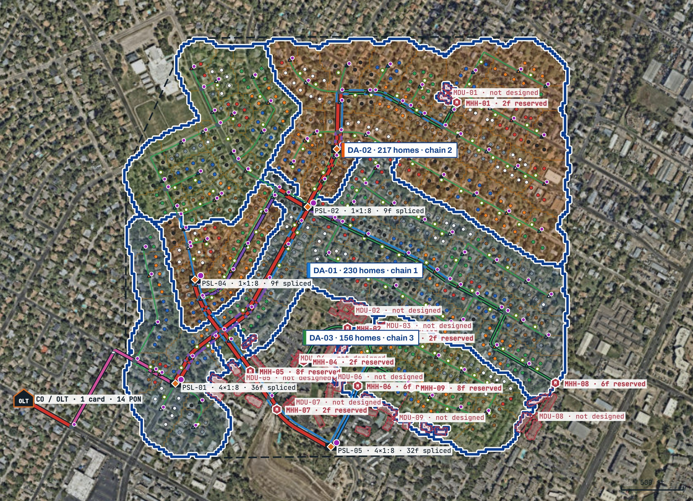

# Fiber Network Tools

Browser-based tools that automate fiber-to-the-home (FTTH) network design and track end-to-end fiber delivery. Everything runs in the browser; uploaded files never leave the user's device.

**Live demos**
- FTTH Design Studio: https://chiamaka-oyekwe.github.io/fiber-network-tools/ftth-design-studio/
- Delivery Command Center (sample data): https://chiamaka-oyekwe.github.io/fiber-network-tools/delivery-command-center/

---

## FTTH Design Studio

Upload a list of addresses and get a complete distributed-split FTTH design in under a second: work that is usually done by hand in GIS or CAD.

*Sample design for 603 homes in the Quail Creek neighborhood of North Austin, Texas (ZIP 78758), on Esri World Imagery: three distribution areas daisy-chained from the OLT, primary splitter sites on the main-road backbone, color-coded cable sizes, and nine MDU complexes flagged with reserved fibers.*

### Inputs
| Layer | Required | Formats |
|---|---|---|
| Address points or building footprints | Yes | Shapefile (.zip or .shp + .dbf + .prj), CSV/TSV (lat/lon, X/Y or WKT), Excel/ODS, GeoJSON, KML/KMZ, GPX |
| Design boundary | No (drawn around the addresses if missing) | Same formats |
| OLT / central office location | No | Point file, or typed latitude, longitude |
| Road centerlines | No (streets approximated if missing) | Same formats |
| Utility poles | No | Same formats; poles flagged unusable in a status column are skipped |

### Design rules (defaults, all adjustable)
- **Architecture:** 1:8 → 1:8 distributed split, compared automatically against 1:4→1:8, 1:8→1:4, 1:2→1:16 and 1:32 centralized
- **MST areas** of up to 8 homes and **distribution areas** of up to 250 homes, with non-overlapping boundaries
- **H-backbone** splitter placement on main roads with shared splitter closures
- **F1 feeder** daisy-chained through the distribution areas (144F minimum on the backbone); **F2 distribution** kept under 72F
- **Front-lot or rear-lot** design
- **MDUs** detected and excluded, each given an entry handhole with reserved feeder fibers
- **Aerial only on usable poles** (uploaded, marked on the map, or a what-if); underground elsewhere
- **Flowerpots only where needed**, handholes and pull points placed automatically
- **Optical loss** checked for every home against GPON or XGS-PON budgets with a 3 dB margin

### Outputs
- Map on aerial, street or plan basemap with color-coded cable sizes, DA and MST boundaries, splitter sites, handholes, splice counts, poles and MDUs
- Design rule check, architecture comparison and per-home cost target
- Bill of materials including rock adders, make-ready, permits and OLT equipment
- CSV schedules (bill of materials, splices and handholes, MSTs, home assignments, MDUs) and a GeoJSON of the full design for QGIS or ArcGIS

### Limits
Unit prices, rock share and permit fees are sample values to replace with local quotes. Rear lot lines are estimated without parcel data. Pole usability must be confirmed with the utility. Output is for planning and estimating; construction drawings still need engineering review.

---

## Delivery Command Center

A program dashboard for fiber builds from design to activation: a jeopardy list with transparent risk scoring (stage age, contractor history, permit backlog, schedule float, budget burn), bottleneck analysis, contractor scorecards, homes-passed burn-up, grant milestones and an auto-written weekly summary. Runs on fictional sample data.

---

## Sample data
The designer opens on a sample neighborhood, **Quail Creek in North Austin, Texas** (around Parkfield Dr and Mearns Meadow Blvd, ZIP 78758), so it shows a finished design right away. The same data is stored in [`data/sample-neighborhood.json`](data/sample-neighborhood.json) for reuse:
- `homes`: `[address, latitude, longitude]` for 603 single-family homes
- `mdus`: 9 multi-dwelling complexes with footprints and estimated units (excluded from the design)
- `nodes` and `ways`: the public street network (`c` is the road class: `t` tertiary, `u` unclassified, `r` residential)

Sample data © [OpenStreetMap contributors](https://www.openstreetmap.org/copyright), available under the Open Database License (ODbL). Aerial basemap imagery © Esri, Maxar, Earthstar Geographics.

## Running locally
The `docs/` folder is a static site. Open `docs/index.html` in a browser, or serve the folder with any static host (GitHub Pages serves it directly).

## Author
Designed and specified by Chiamaka Oyekwe, built with AI-assisted development.
